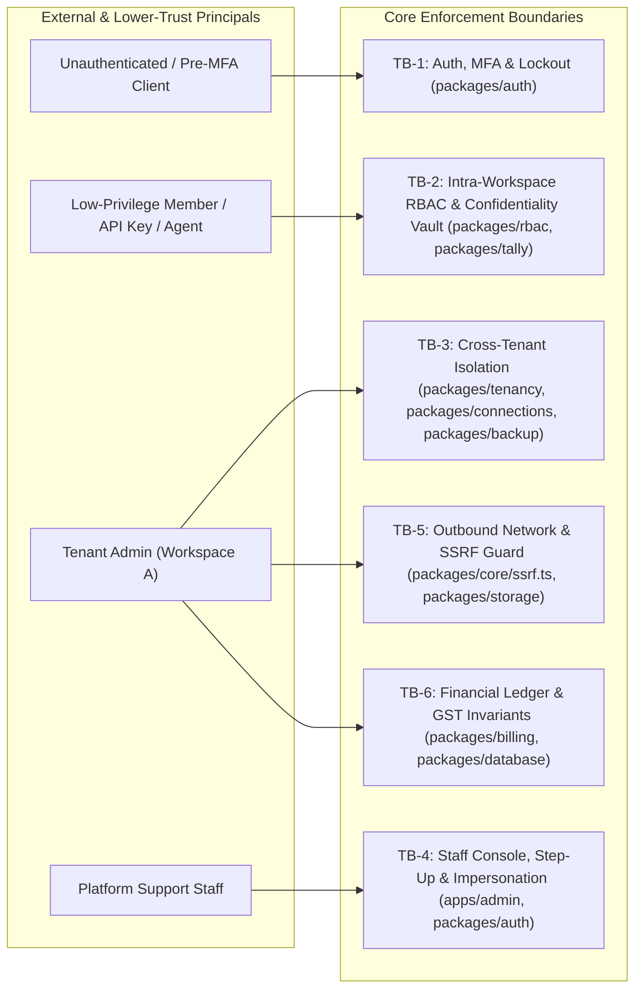

# Security Audit Report — RapidShift Labs (`rslmarketing`)

- **Project Slug**: `rslmarketing`
- **Target Root**: `c:/Users/DELL/Downloads/rslmarketing`
- **Run ID**: `run-1` (`C:/Users/DELL/security-audit-skill/rslmarketing/run-1/`)
- **Source Reference**: `4ceaec7855ed7c8a398bd387d39237338685e136` (with dirty worktree UI changes in `packages/ui/src/theme.css`, `apps/web/src/components/workspace-chrome.tsx`, `apps/admin/src/components/admin-nav.tsx`, `apps/web/src/app/(dashboard)/layout.tsx`)
- **Audit Mode**: Full End-to-End Static Source Security Audit (`SAFE FULFILL — Analyze & Defend`)
- **Date**: 2026-11-10

---

## 1. Executive Summary

A comprehensive, source-grounded security audit was conducted across the entire `rslmarketing` monorepo, spanning all **4 runtime applications** (`apps/web`, `apps/admin`, `apps/worker`, `apps/tally-agent`) and **21 internal packages** (`packages/*`), including **40 HTTP Route Handler files (48 method handlers)**, **153 Customer Web Server Actions**, **56 Platform Admin Server Actions**, **8 BullMQ background queues**, and **SQLite Control/Tenant DDL schemas**.

The codebase demonstrates several strong foundational security patterns—including **HKDF-SHA256 + AES-256-GCM** envelope encryption with per-tenant context binding (`packages/core/src/crypto.ts`), **Argon2id** password hashing, **SHA-256** hashed session and API tokens, **constant-time HMAC verification** (`crypto.timingSafeEqual`) across external webhooks (`WhatsApp`, `Meta`, `Cashfree`, `Razorpay`, `Tally`, `Agent`), **SQLite append-only immutability triggers** on `wallet_ledger` and `invoices`, and **XML `<!DOCTYPE`/`<!ENTITY` rejection** against XXE (`packages/tally/src/index.ts`).

However, the audit identified **17 confirmed source-verified vulnerabilities** (**1 Critical, 9 High, 7 Medium**) and **2 `NEEDS VALIDATION` architectural/deployment leads**:

| Severity / Verdict | Count | Key Themes |
| :--- | :---: | :--- |
| **Critical** | **1** | Pre-MFA platform staff TOTP secret overwrite enabling complete 2FA & step-up bypass (`RSL-FIND-001`) |
| **High** | **9** | Support impersonation escalation & cross-workspace pivot (`RSL-FIND-002`); `/queues` live reset/OTP token exposure & unscoped password reset (`RSL-FIND-003`); cross-tenant webhook routing hijack (`RSL-FIND-004`); cross-tenant `.rslbackup` restore (`RSL-FIND-005`); stored same-origin XSS in `/api/media` (`RSL-FIND-006`); Confidentiality Vault & Owner OTP masking bypasses (`RSL-FIND-007`); suspended tenant read-write bypass (`RSL-FIND-008`); 18% GST under-debit & cross-workspace UTR replay (`RSL-FIND-009`); SSRF in Web Push, R2/S3 storage & WhatsApp media fetch (`RSL-FIND-010`) |
| **Medium** | **7** | API key wildcard (`"*"`) scope injection (`RSL-FIND-011`); passkey lockout/MFA bypass & missing customer TOTP rate limits (`RSL-FIND-012`); legacy admin Turnstile bypass & silent existing-user password overwrite (`RSL-FIND-013`); server-side `127.0.0.1` port scanning (`RSL-FIND-014`); Tally `webhookToken` leak to `tally:read` API keys (`RSL-FIND-015`); 4 Web Server Actions missing `authorize()` (`RSL-FIND-016`); non-transactional `consumeUsage` race & missing `ad_spend_ledger` triggers (`RSL-FIND-017`) |
| **Low** | **0** | — |
| **`NEEDS VALIDATION`** | **2** | Reverse-proxy `X-Forwarded-Host` trust in CSRF/Setup/WebAuthn (`RSL-NV-001`); local loopback daemon (`127.0.0.1:4520`), Redis (`4579`) & `/tmp` Nginx script hardening (`RSL-NV-002`) |

---

## 2. Architecture, Security Principals & Trust Boundaries

### 2.1 Security Principals (Lowest to Highest Privilege)
1. **Unauthenticated External Client**: Public web visitor, webhook caller, or API caller without credentials.
2. **Pre-MFA Authenticated Principal (`pendingMfa = true`)**: Customer or Platform Staff session that has passed primary password verification and is restricted to `/mfa` enrollment/verification.
3. **Cross-Workspace Customer User**: Authenticated user in Workspace A attempting to access or hijack resources belonging to Workspace B.
4. **Low-Privilege Workspace Member (`viewer`, `analyst`, `accountant`, `operator`, `manager`)**: Authenticated member within a workspace constrained by `ROLE_PERMISSIONS` (`packages/rbac/src/index.ts:141-208`) and Tally Confidentiality Vault masking.
5. **Scoped API Key (`rsl_live_*`) & Desktop Tally Agent (`rsl_agent_*`)**: Programmatic actors restricted to specific workspace scopes or Tally ingestion endpoints.
6. **Workspace `admin` / `owner`**: Full tenant administrator within a single workspace; untrusted with respect to other tenants, platform billing ledger integrity, and host loopback/internal networks.
7. **Low-Privilege Platform Staff (`auditor`, `support`, `billing_admin`, `ops_admin`)**: Constrained by `STAFF_ROLE_PERMISSIONS` (`packages/rbac/src/index.ts:320-366`), 15-minute `stepUpAt` verification, and single-workspace temporary impersonation (`impersonatorStaffId`).
8. **Platform `super_admin` & Host OS**: Highest control plane privilege.

### 2.2 Trust Boundaries Map



### 2.3 Coverage Ledger Summary

| Coverage Unit | Subsystem Scope | Entrypoints / Files Reviewed | Status | Result Fingerprints |
| :--- | :--- | :--- | :---: | :--- |
| **Unit 1 — Admin Control Plane & Staff/Customer Auth** | `packages/auth`, `packages/rbac`, `packages/api-keys`, `apps/admin/**` | 56 Admin Server Actions, Admin pages, middleware, sessions, passkeys, TOTP | `candidate` | `RSL-FIND-001`, `RSL-FIND-002`, `RSL-FIND-003`, `RSL-FIND-011`, `RSL-FIND-012`, `RSL-FIND-013`, `RSL-NV-001` |
| **Unit 2 — Customer Web Portal Routes & Actions** | `apps/web/src/app/api/**`, `apps/web/src/lib/domains/**`, `apps/web/next.config.ts` | 40 HTTP route files (48 handlers), 153 Web Server Actions | `candidate` | `RSL-FIND-006`, `RSL-FIND-015`, `RSL-FIND-016` |
| **Unit 3 — Tally Prime, Confidentiality, Storage, Backup & Connections** | `packages/tally`, `packages/backup`, `packages/storage`, `packages/connections`, `packages/core/src/ssrf.ts`, `apps/tally-agent` | XML/CSV/JSON parsers, TDL/BAT generators, Vault OTP, `.rslbackup`, R2/S3, SSRF | `candidate` | `RSL-FIND-004`, `RSL-FIND-005`, `RSL-FIND-007`, `RSL-FIND-010`, `RSL-FIND-014` |
| **Unit 4 — Billing, Wallet Ledger, Multi-Tenant DB & Infra** | `packages/billing`, `packages/tenancy`, `packages/database`, `packages/inbox`, `packages/notifications`, `infra/**`, `setup.sh`, `update.sh` | Double-entry wallet/ad-spend ledgers, GST invoices, payment webhooks, SQLite handles, Web Push, PM2/Nginx scripts | `candidate` | `RSL-FIND-008`, `RSL-FIND-009`, `RSL-FIND-017`, `RSL-NV-002` |

---

## 3. Summary of Confirmed Findings & Validation Leads

### 3.1 Confirmed Vulnerabilities (`confirmed`)

| ID | Severity | Title | Primary Location | Principal -> Boundary Crossed |
| :--- | :---: | :--- | :--- | :--- |
| **`RSL-FIND-001`** | **Critical** | Pre-MFA Platform Staff TOTP Secret Overwrite Enables Complete Staff 2FA & Step-Up Bypass | `apps/admin/src/lib/actions.ts:380`, `packages/auth/src/index.ts:2562` | Pre-MFA Staff Session -> Full MFA & Step-Up Staff Console (`TB-1`) |
| **`RSL-FIND-002`** | **High** | Support Staff Impersonation Session Can Escalate to Permanent Customer Account Takeover & Cross-Workspace Pivot | `packages/auth/src/index.ts:858, 2821`, `apps/web/src/lib/domains/auth-team.ts:461, 716` | Support Impersonator -> Permanent Customer Owner & Other Workspaces (`TB-4`) |
| **`RSL-FIND-003`** | **High** | Support Staff Can Read Live Password Reset Links, OTPs & Invite Tokens in `/queues` and Reset Arbitrary Cross-Workspace User Passwords | `apps/admin/src/app/(console)/queues/page.tsx:84, 368`, `packages/auth/src/index.ts:2972` | Support Staff -> Global Customer Account Takeover (`TB-4`) |
| **`RSL-FIND-004`** | **High** | Cross-Tenant Webhook Routing Hijack via Unconditional `onConflictDoUpdate` in `upsertRoutingEntry` & Unfiltered `connections` Lookup | `packages/connections/src/index.ts:475`, `apps/web/src/lib/domains/connections-developers.ts:411` | Tenant A Admin -> Tenant B Inbound Webhook Stream (`TB-3`) |
| **`RSL-FIND-005`** | **High** | Cross-Tenant Backup Archive Restore (`restoreSignedEncryptedBackup` Never Verifies `bundle.manifest.tenantId === ctx.workspaceId`) | `packages/backup/src/index.ts:317, 340`, `apps/web/src/app/api/export/[kind]/route.ts:42` | Tenant A Backup Archive / `backup:view` -> Tenant B DB Restore (`TB-3`) |
| **`RSL-FIND-006`** | **High** | Stored Same-Origin XSS via Unvalidated Media Upload MIME Type in `/api/media/[workspaceId]/[objectId]` | `apps/web/src/lib/domains/campaigns-reviews.ts:40`, `apps/web/src/app/api/media/[workspaceId]/[objectId]/route.ts:30` | Campaign Operator -> Same-Origin JS in Owner/Staff Browser (`TB-2`) |
| **`RSL-FIND-007`** | **High** | Confidentiality Vault & Owner OTP Masking Bypasses Across Self-Issued OTP, `allowApiUnmaskedAccessOnly` Precedence, Inventory/Ledger Queries, and Exports | `apps/web/src/lib/domains/tally-inventory.ts:1093`, `packages/tally/src/confidentiality.ts:288`, `apps/web/src/app/api/export/[kind]/route.ts:203` | `tally:view` Member -> Unmasked Financial & Party PII (`TB-2`) |
| **`RSL-FIND-008`** | **High** | Suspended Tenant Enforcement Bypass via Default `allowSuspendedRead = true` Returning Read-Write SQLite Handles | `packages/tenancy/src/index.ts:238, 282` | Suspended Workspace -> Full Read-Write Tenant DB Access (`TB-3`) |
| **`RSL-FIND-009`** | **High** | Billing & Financial Ledger Integrity Flaws (18% GST Under-Debit in `activateServiceEntitlement` & Cross-Workspace UTR Replay) | `packages/billing/src/index.ts:1486, 1849`, `packages/database/src/ddl.ts:842` | Tenant Billing Admin -> Platform Wallet Ledger & Tax Invoices (`TB-6`) |
| **`RSL-FIND-010`** | **High** | SSRF & Cross-Tenant Overwrite Vectors in Web Push (`/api/push/subscribe`), Storage (`client_r2` / `custom_s3`), and Inbound WhatsApp Media Fetch | `packages/notifications/src/web-push.ts:156`, `packages/storage/src/index.ts:255, 654`, `packages/inbox/src/webhook-processors.ts:515` | Workspace User / Webhook -> Outbound Server Network & Cross-Tenant Push (`TB-5`) |
| **`RSL-FIND-011`** | **Medium** | API Key Wildcard Scope (`"*"`) Injection & Over-Privileged `API_KEY_PERMISSION_MAP` | `packages/api-keys/src/index.ts:175, 413`, `packages/rbac/src/index.ts:218` | `apikeys:manage` / Scoped API Key -> All Scopes & Admin Permissions (`TB-2`) |
| **`RSL-FIND-012`** | **Medium** | WebAuthn Passkey Login Ignores `user.lockedUntil`, `UV` Flag, and `user.totpEnabled`, plus Missing Rate Limits on Customer TOTP & Step-Up | `packages/auth/src/passkeys.ts:341`, `packages/auth/src/index.ts:533, 1426, 2005` | Pre-MFA / Locked User -> Lockout & 2FA Bypass (`TB-1`) |
| **`RSL-FIND-013`** | **Medium** | Legacy Admin `staffBootstrapOrLoginAction` Bypasses Turnstile, Silent Existing-User Addition in `addOrInviteTeamMember`, and Unverified `/api/auth/reset-handoff` Cookie | `apps/admin/src/lib/actions.ts:490`, `packages/auth/src/index.ts:1013`, `apps/web/src/app/api/auth/reset-handoff/route.ts:18` | Unauthenticated / Workspace Admin -> Turnstile Bypass & OAuth User Password Set (`TB-1`) |
| **`RSL-FIND-014`** | **Medium** | Server-Side Localhost Port Scanning (`127.0.0.1:1024..65535`) via `fetchAndSyncLocalTallyPort9000` in Cloud Production | `packages/tally/src/index.ts:9008`, `apps/web/src/lib/domains/tally-inventory.ts:313` | `tally:sync` Operator -> Host `127.0.0.1` Loopback Services (`TB-5`) |
| **`RSL-FIND-015`** | **Medium** | Tally `webhookToken` Disclosure to Scoped API Keys, Missing `tally.sync` Entitlement Checks in Agent Routes, and Missing Replay Cache in `verifyAgentSignedRequest` | `apps/web/src/app/api/webhooks/tally/route.ts:327`, `apps/web/src/app/api/agent/vouchers/route.ts:17` | `tally:read` API Key / Agent -> Tally Write Token & Unentitled Sync (`TB-2`) |
| **`RSL-FIND-016`** | **Medium** | Missing RBAC `authorize()` Calls in 4 Web Server Actions & Over-Broad Staff Tenant Mapping in `authorizeNonUserActor` | `apps/web/src/lib/domains/campaigns-reviews.ts:259, 478`, `apps/web/src/lib/domains/inbox-whatsapp.ts:378, 410` | `viewer` Member -> Ad Insights Sync & AI/Template Operations (`TB-2`) |
| **`RSL-FIND-017`** | **Medium** | Non-Transactional `consumeUsage` Race, Missing `ad_spend_ledger` Immutability Triggers, and Unvalidated `serverUrl` / `extractedToken` in Tally `.bat` & `.tdl` Generators | `packages/billing/src/index.ts:1756, 2368`, `packages/database/src/ddl.ts:746`, `packages/tally/src/index.ts:6149` | Concurrent Requests / Config Input -> Usage Drift, Ad Ledger Delete & Script Injection (`TB-6`) |

### 3.2 `NEEDS VALIDATION` Leads (`needs_validation` — Unscored)

| ID | Status | Title | Primary Location | Validation Blocker |
| :--- | :---: | :--- | :--- | :--- |
| **`RSL-NV-001`** | `NEEDS VALIDATION` | Proxy Header Trust (`X-Forwarded-Host` / `X-Forwarded-Proto`) in CSRF Origin Check, Admin Setup Subdomain Gate, and WebAuthn `rpId`/`origin` Resolution | `apps/web/src/middleware.ts:14`, `apps/admin/src/lib/session.ts:14`, `apps/web/src/app/api/auth/passkey/login/verify/route.ts:9` | Depends on live firewall rules for ports `4500`/`4501` and upstream Nginx/CDN header stripping. |
| **`RSL-NV-002`** | `NEEDS VALIDATION` | Local Host Daemon & Deployment Controls (Unauthenticated `127.0.0.1:4520` Cleanup Trigger, Unauthenticated Redis on `127.0.0.1:4579`, Predictable `/tmp` Nginx Config Path, and Windows `O_NOFOLLOW` Blocker) | `infra/pm2/rsl-cleanup-service.ts:334`, `setup.sh:66, 225`, `update.sh:125` | Depends on multi-user host access or an SSRF primitive capable of hitting `127.0.0.1:4520` / `4579`. |

---

## 4. Detailed Confirmed Findings

---

### `RSL-FIND-001` [Critical] — Pre-MFA Platform Staff TOTP Secret Overwrite Enables Complete Staff 2FA & Step-Up Bypass

- **Verdict**: `confirmed` | **Severity**: **Critical** (Likelihood: High, Impact: Critical) | **Confidence**: High
- **Attack Class**: Authentication & Multi-Factor Authentication Bypass (`CWE-287`)
- **Lower-Trust Principal**: Pre-MFA Platform Staff session (`rsl_staff_session` after password verification at `/login`, redirected to `/mfa`)
- **Crossed Trust Boundary**: `TB-1` (Pre-MFA Staff Session -> Full MFA-Verified & Step-Up Verified Staff Console Session)

#### Vulnerability Description & Root Cause
When a platform staff member (`super_admin`, `ops_admin`, `billing_admin`, `support`, `auditor`) logs in with their email and password, `loginPlatformStaff` creates a staff session with `mfaVerifiedAt: null` and redirects the browser to `/mfa`. To support initial authenticator setup, `apps/admin/src/lib/actions.ts` exports `staffBeginTotpEnrollmentAction` and `staffConfirmTotpEnrollmentAction`, both of which authenticate the caller via `getPendingMfaStaffSession()` (`allowPendingMfa: true`).

However, neither `staffBeginTotpEnrollmentAction` (`apps/admin/src/lib/actions.ts:380-405`) nor `beginPlatformStaffTotpEnrollment` (`packages/auth/src/index.ts:2562-2601`) checks whether `staff.totpEnabled` (`pending.mfaEnrolled`) is already `true`. Calling `staffBeginTotpEnrollmentAction` with a pre-MFA session unconditionally generates a fresh TOTP secret, overwrites `totpSecretEncrypted` on `controlSchema.staffUsers`, and returns the plaintext `secret` and `otpauthUri` in the response. Calling `staffConfirmTotpEnrollmentAction` with a 6-digit code derived from that returned secret then marks the staff session as both `mfaVerifiedAt: now` and `stepUpAt: now`.

*(Note: By contrast, the customer TOTP enrollment function `beginUserTotpEnrollment` at `packages/auth/src/index.ts:1921` explicitly checks `if (user.totpEnabled) throw new RslError("RSL-AUTH-1006", ...)`; that check was omitted in `beginPlatformStaffTotpEnrollment`.)*

#### Source Trace (`entrypoint` -> `propagation` -> `sink`)
1. **`entrypoint`** — `apps/admin/src/lib/actions.ts:380` (`staffBeginTotpEnrollmentAction`):
   - Calls `const pending = await getPendingMfaStaffSession();` (`line 384`) without checking `pending.mfaEnrolled`, then calls `beginPlatformStaffTotpEnrollment({ staffId: pending.staffId })` (`line 389`).
2. **`propagation`** — `apps/admin/src/lib/session.ts:40` (`getPendingMfaStaffSession`):
   - Calls `validateStaffSession(raw, { allowPendingMfa: true })`, returning any active staff session that has only passed password authentication.
3. **`propagation`** — `packages/auth/src/index.ts:2562` (`beginPlatformStaffTotpEnrollment`):
   - Loads `staff` from `controlSchema.staffUsers` (`lines 2573-2577`), checks only `if (!staff || staff.status !== "active")` (`line 2578`), generates a new secret (`line 2582`), overwrites `totpSecretEncrypted` (`lines 2584-2590`), and returns `{ secret, otpauthUri }` (`lines 2593-2598`).
4. **`sink`** — `packages/auth/src/index.ts:2603` (`confirmPlatformStaffTotpEnrollment`):
   - Verifies the TOTP code against the overwritten `totpSecretEncrypted` (`line 2624`) and updates `controlSchema.staffSessions` with `mfaVerifiedAt: now, stepUpAt: now` (`lines 2639-2643`).

#### Remediation
Check `staff.totpEnabled` in `beginPlatformStaffTotpEnrollment` (`packages/auth/src/index.ts:2578`) and `pending.mfaEnrolled` in `staffBeginTotpEnrollmentAction` / `staffConfirmTotpEnrollmentAction` (`apps/admin/src/lib/actions.ts:385, 415`):

```ts
// packages/auth/src/index.ts (inside beginPlatformStaffTotpEnrollment, line 2578)
if (!staff || staff.status !== "active") {
  throw new RslError("RSL-AUTH-1001", "Active platform staff user not found.");
}
if (staff.totpEnabled) {
  throw new RslError(
    "RSL-AUTH-1006",
    "Authenticator MFA is already enabled for this staff account."
  );
}
```

```ts
// apps/admin/src/lib/actions.ts (inside staffBeginTotpEnrollmentAction, line 385)
const pending = await getPendingMfaStaffSession();
if (!pending) {
  return { ok: false, error: "Staff session expired. Please sign in again." };
}
if (pending.mfaEnrolled) {
  return { ok: false, error: "Authenticator MFA is already enrolled for this account." };
}
```

---

### `RSL-FIND-002` [High] — Support Staff Impersonation Session Can Escalate to Permanent Customer Account Takeover & Cross-Workspace Pivot

- **Verdict**: `confirmed` | **Severity**: **High** (Likelihood: High, Impact: High) | **Confidence**: High
- **Attack Class**: Privilege Escalation & Impersonation Boundary Escape (`CWE-269`)
- **Lower-Trust Principal**: Platform `support` staff (`staff:tenants.impersonate`) holding a temporary 30-minute impersonation session
- **Crossed Trust Boundary**: `TB-4` (Temporary Single-Workspace Support Impersonation -> Permanent Customer Account Ownership & Cross-Workspace Access)

#### Vulnerability Description & Root Cause
When platform staff initiate tenant impersonation via `staffStartImpersonationAction` -> `createImpersonationSession` (`packages/auth/src/index.ts:2821-2896`), a session row is inserted into `controlSchema.sessions` with `userId: ws.ownerUserId`, `activeWorkspaceId: ws.id`, and `impersonatorStaffId: params.staffId`. While `validateSession` exposes `impersonatorStaffId` on the returned `AuthenticatedSession` object, downstream workspace switching and user credential management endpoints never check `session.impersonatorStaffId !== null`:

1. **Unlogged Cross-Workspace Pivot**: `switchActiveWorkspace` (`packages/auth/src/index.ts:858-886`, invoked via `switchWorkspaceActionImpl` at `apps/web/src/lib/domains/auth-team.ts:348` and `switchWorkspaceJsonActionImpl` at `line 1038`) updates `controlSchema.sessions.activeWorkspaceId` to any other workspace where `ws.ownerUserId` is a member, without checking `impersonatorStaffId` or recording an impersonation audit event for the second workspace.
2. **WebAuthn Passkey Registration/Deletion on Customer Account**: `POST /api/auth/passkey/register/options` (`apps/web/src/app/api/auth/passkey/register/options/route.ts:13`) and `POST`/`DELETE /api/auth/passkey/register/verify` (`apps/web/src/app/api/auth/passkey/register/verify/route.ts:20, 72`) allow the impersonating session to register a new passkey on `ws.ownerUserId` (or delete the owner's existing passkeys), granting persistent passwordless login as the customer after the impersonation session ends.
3. **Owner Email & TOTP Takeover**: `saveUserProfileJsonActionImpl` (`apps/web/src/lib/domains/auth-team.ts:716`) allows changing the customer owner's login email address without password re-entry or checking `impersonatorStaffId`. Similarly, `beginUserTotpEnrollmentJsonActionImpl` (`line 1053`), `confirmUserTotpEnrollmentJsonActionImpl` (`line 1077`), and `disableUserTotpMfaJsonActionImpl` (`line 1116`) allow enrolling or replacing the customer's TOTP MFA.
4. **Permanent `owner` Invitation with `assertUserEmailVerified` Bypass**: `inviteTeamMemberActionImpl` (`apps/web/src/lib/domains/auth-team.ts:461`) explicitly skips email verification when impersonating (`if (!session.impersonatorStaffId) { assertUserEmailVerified(session); }`) and permits inviting an external email with `role: "owner"` and an `initialPassword`.

#### Source Trace (`entrypoint` -> `propagation` -> `sink`)
1. **`entrypoint`** — `packages/auth/src/index.ts:2821` (`createImpersonationSession`):
   - Inserts a session for `userId: ws.ownerUserId` with `impersonatorStaffId: params.staffId`.
2. **`propagation`** — `packages/auth/src/index.ts:858` (`switchActiveWorkspace`):
   - Updates `controlSchema.sessions.activeWorkspaceId` for `params.sessionId` without checking `sessionRow.impersonatorStaffId`.
3. **`sink`** — `apps/web/src/lib/domains/auth-team.ts:461, 716, 1053` & `apps/web/src/app/api/auth/passkey/register/verify/route.ts:20, 72`:
   - Mutates `controlSchema.users.email`, `controlSchema.userPasskeys`, `controlSchema.users.totpSecretEncrypted`, or `controlSchema.memberships` (`role: "owner"`) while `session.impersonatorStaffId` is active.

#### Remediation
Enforce a helper `assertNotImpersonating(session)` across workspace switching, account profile/password/TOTP/passkey/session revocation endpoints, and block `role === "owner"` invitations during impersonation:

```ts
// packages/auth/src/index.ts (inside switchActiveWorkspace, line 862)
const currentSession = db
  .select({ impersonatorStaffId: controlSchema.sessions.impersonatorStaffId })
  .from(controlSchema.sessions)
  .where(eq(controlSchema.sessions.id, params.sessionId))
  .get();
if (currentSession?.impersonatorStaffId) {
  throw new RslError(
    "RSL-AUTH-1005",
    "Switching workspaces is not permitted during a support impersonation session; start a new scoped impersonation session instead."
  );
}
```

```ts
// apps/web/src/lib/domains/auth-team.ts (helper enforced in profile, password, TOTP, session revoke, and owner invite actions)
function assertNotImpersonating(session: { impersonatorStaffId?: string | null }) {
  if (session.impersonatorStaffId) {
    throw new RslError(
      "RSL-AUTH-1005",
      "Customer account credentials, MFA, and owner memberships cannot be modified during support impersonation."
    );
  }
}
```

---

### `RSL-FIND-003` [High] — Support Staff Can Read Live Password Reset Links, OTPs & Invite Tokens in `/queues` and Reset Arbitrary Cross-Workspace User Passwords

- **Verdict**: `confirmed` | **Severity**: **High** (Likelihood: High, Impact: High) | **Confidence**: High
- **Attack Class**: Sensitive Secret Exposure & Cross-Tenant Admin Scope Bypass (`CWE-200`, `CWE-863`)
- **Lower-Trust Principal**: Low-privilege platform `support` staff (`staff:ops.view` / `staff:tenants.support`)
- **Crossed Trust Boundary**: `TB-4` (Platform Support Role -> Arbitrary Customer Account Takeover & Unscoped User Mutation)

#### Vulnerability Description & Root Cause
1. **Unredacted Global Email Outbox in `/queues`**: `apps/admin/src/app/(console)/queues/page.tsx:84-105` requires only `staff:ops.view` (granted to `support` and `ops_admin`, with no `requireStaffStepUpOrRedirect` and no audit log) and calls `listRecentEmails(undefined, 30)` (`packages/notifications/src/index.ts:617-634`). At `lines 366-398`, `QueuesPage` parses `payloadJson` and renders a clickable `<a href={preview.actionUrl}>Open Action Link</a>` as well as `<iframe srcDoc={mail.renderedHtml} />`. Because `emailOutbox` stores password reset emails (`/api/auth/reset-handoff?email=...&token=...`), team invitations (`/accept-invite?token=...`), email verification links, and 6-digit Confidentiality Vault unmask OTPs across all workspaces, any `support` staff member can harvest live tokens and take over customer accounts.
2. **Unscoped `userId` in `staffResetClientPasswordAction` and `staffVerifyClientEmailAction`**: `apps/admin/src/lib/actions.ts:1397-1463` accepts `workspaceId` and `userId` from form data and calls `staffResetClientUserPassword` / `staffVerifyClientUserEmail` (`packages/auth/src/index.ts:2972-3024`). Both functions update `controlSchema.users` by `eq(controlSchema.users.id, params.userId)` without checking that `userId` is actually a member of `params.workspaceId` in `controlSchema.memberships`.

#### Source Trace (`entrypoint` -> `propagation` -> `sink`)
1. **`entrypoint`** — `apps/admin/src/app/(console)/queues/page.tsx:84, 105` (`QueuesPage`) & `apps/admin/src/lib/actions.ts:1397` (`staffResetClientPasswordAction`).
2. **`propagation`** — `packages/notifications/src/index.ts:617` (`listRecentEmails`) returns raw `payloadJson` and `renderedHtml`.
3. **`sink`** — `apps/admin/src/app/(console)/queues/page.tsx:368, 391` renders `preview.actionUrl` and `mail.renderedHtml`; `packages/auth/src/index.ts:2982` updates `controlSchema.users.passwordHash` for any `params.userId`.

#### Remediation
1. In `listRecentEmails` (`packages/notifications/src/index.ts:617`), redact query parameters (`token`, `code`, `otp`) in `payloadJson` and mask 6-digit OTPs / token URLs in `renderedHtml` before returning rows to the Admin UI.
2. In `staffResetClientUserPassword` and `staffVerifyClientUserEmail` (`packages/auth/src/index.ts:2972, 3000`), verify that `(params.workspaceId, params.userId)` exists in `controlSchema.memberships`:

```ts
// packages/auth/src/index.ts (inside staffResetClientUserPassword & staffVerifyClientUserEmail)
const membership = db
  .select({ id: controlSchema.memberships.id })
  .from(controlSchema.memberships)
  .where(
    and(
      eq(controlSchema.memberships.workspaceId, params.workspaceId),
      eq(controlSchema.memberships.userId, params.userId)
    )
  )
  .get();
if (!membership) {
  throw new RslError("RSL-AUTH-1005", "Target user is not a member of the specified workspace.");
}
```

---

### `RSL-FIND-004` [High] — Cross-Tenant Webhook Routing Hijack via Unconditional `onConflictDoUpdate` in `upsertRoutingEntry` & Unfiltered `connections` Lookup

- **Verdict**: `confirmed` | **Severity**: **High** (Likelihood: High, Impact: High) | **Confidence**: High
- **Attack Class**: Cross-Tenant Isolation Bypass / Webhook Hijacking (`CWE-284`)
- **Lower-Trust Principal**: Workspace `admin`/`owner` or `operator` (`connections:manage`) in an attacker-controlled workspace
- **Crossed Trust Boundary**: `TB-3` (Attacker Workspace -> Victim Workspace Inbound WhatsApp/Meta/Google Webhook Stream)

#### Vulnerability Description & Root Cause
Inbound webhooks from WhatsApp (`phone_number_id` / `waba_id`), Meta (`page_id` / `ig_account_id` / `ad_account_id`), and Google (`location_id`) do not carry an RSL `workspaceId`; they are routed to a tenant database by looking up the external asset identifier in `controlSchema.connections` and `controlSchema.assetRouting`.

Three compounding flaws allow any workspace with `connections:manage` to hijack another tenant's inbound webhooks:
1. **Unconditional Overwrite in `upsertRoutingEntry`**: `packages/connections/src/index.ts:475-492` executes `.insert(controlSchema.assetRouting).values(...).onConflictDoUpdate({ target: [controlSchema.assetRouting.provider, controlSchema.assetRouting.externalId], set: { tenantId: workspaceId, connectionId, updatedAt: now } })` without checking if the existing `assetRouting` entry belongs to a different `tenantId`.
2. **Missing Manual Credentials Gate on `updateConnectionJsonActionImpl`**: While `connectAccountActionImpl` (`apps/web/src/lib/domains/connections-developers.ts:137`) calls `assertManualCredentialsAllowedForWorkspace(session.workspace.id)`, `updateConnectionJsonActionImpl` (`lines 411-494`) omits this check and allows updating `externalAccountId` on any connection via `updateExternalConnection` (`packages/connections/src/index.ts:668-754`), which calls `upsertRoutingEntry` at `line 732`.
3. **Unfiltered `connections` Lookup in `webhook-processors.ts`**: `packages/inbox/src/webhook-processors.ts:237-248` (WhatsApp) and `745-767` (Meta) query `controlSchema.connections` *before* `controlSchema.assetRouting` and do not filter by `eq(controlSchema.connections.status, "healthy")`.

#### Source Trace (`entrypoint` -> `propagation` -> `sink`)
1. **`entrypoint`** — `apps/web/src/lib/domains/connections-developers.ts:411` (`updateConnectionJsonActionImpl`).
2. **`propagation`** — `packages/connections/src/index.ts:668, 732` (`updateExternalConnection` -> `upsertRoutingEntry`).
3. **`sink`** — `packages/connections/src/index.ts:475` (`upsertRoutingEntry` overwrites `assetRouting.tenantId`) & `packages/inbox/src/webhook-processors.ts:237, 745` (routes inbound webhooks to the hijacker's tenant database).

#### Remediation
1. In `upsertRoutingEntry` (`packages/connections/src/index.ts:475`), check if `(provider, externalId)` is already registered to another `tenantId` and throw `RslError("RSL-CONN-1002", ...)`.
2. Call `assertManualCredentialsAllowedForWorkspace(session.workspace.id)` in `updateConnectionJsonActionImpl` (`apps/web/src/lib/domains/connections-developers.ts:438`).
3. In `packages/inbox/src/webhook-processors.ts:237, 745`, resolve tenant routing from `controlSchema.assetRouting` first and require `eq(controlSchema.connections.status, "healthy")` on fallback queries:

```ts
// packages/connections/src/index.ts (inside upsertRoutingEntry, line 476)
const existing = db
  .select({ tenantId: controlSchema.assetRouting.tenantId })
  .from(controlSchema.assetRouting)
  .where(
    and(
      eq(controlSchema.assetRouting.provider, provider),
      eq(controlSchema.assetRouting.externalId, externalId)
    )
  )
  .get();
if (existing && existing.tenantId !== workspaceId) {
  throw new RslError(
    "RSL-CONN-1002",
    "This external account or phone number ID is already linked to another active workspace."
  );
}
```

---

### `RSL-FIND-005` [High] — Cross-Tenant Backup Archive Restore (`restoreSignedEncryptedBackup` Never Verifies `bundle.manifest.tenantId === ctx.workspaceId`)

- **Verdict**: `confirmed` | **Severity**: **High** (Likelihood: High, Impact: High) | **Confidence**: High
- **Attack Class**: Cross-Tenant Cryptographic Context Confusion & Over-Permissive Export (`CWE-345`, `CWE-863`)
- **Lower-Trust Principal**: Workspace `analyst`/`accountant` (`backup:view`) in Workspace A who is also `owner`/`admin` (`backup:manage`) of a personal Workspace B
- **Crossed Trust Boundary**: `TB-3` (Workspace A `.rslbackup` Archive -> Workspace B Tenant Database Restore)

#### Vulnerability Description & Root Cause
When a `.rslbackup` archive is generated via `createSignedEncryptedBackup` (`packages/backup/src/index.ts:138-280`), the plaintext snapshot is encrypted via `encryptEnvelope(plaintext, "tenant-backup", ctx.workspaceId)` and signed with a platform-wide HMAC key (`env.BACKUP_SIGNING_KEY`).

When restoring a backup via `restoreBackupActionImpl` (`apps/web/src/lib/domains/storage-privacy.ts:213-239`) -> `restoreSignedEncryptedBackup(ctx, rawBundleJson)` (`packages/backup/src/index.ts:289-484`):
1. `restoreSignedEncryptedBackup` verifies the global HMAC signature (`lines 317-321`), which is valid for any `.rslbackup` produced by the platform.
2. At `line 340`, it decrypts the payload by calling `decryptEnvelope(bundle.ciphertext, "tenant-backup", bundle.manifest.tenantId)`—passing `bundle.manifest.tenantId` from the untrusted JSON file rather than `ctx.workspaceId`!
3. Nowhere in `restoreSignedEncryptedBackup` is `bundle.manifest.tenantId` compared against `ctx.workspaceId`. The decrypted contacts, campaigns, templates, reviews, Tally vouchers, and Tally sync state from Workspace A are then inserted directly into `tenantDataDb(ctx.workspaceId)` (Workspace B).
4. Compounding this issue, `GET /api/export/backup-bundle` (`apps/web/src/app/api/export/[kind]/route.ts:42, 298-307`) requires only `backup:view` (held by read-only `analyst` and `accountant` roles) to generate and download a fresh `.rslbackup` archive containing all unmasked tenant data.

#### Source Trace (`entrypoint` -> `propagation` -> `sink`)
1. **`entrypoint`** — `apps/web/src/lib/domains/storage-privacy.ts:213` (`restoreBackupActionImpl`) & `apps/web/src/app/api/export/[kind]/route.ts:42, 298` (`GET /api/export/backup-bundle`).
2. **`propagation`** — `packages/backup/src/index.ts:317, 340` (`restoreSignedEncryptedBackup` verifies global HMAC and calls `decryptEnvelope(..., bundle.manifest.tenantId)`).
3. **`sink`** — `packages/backup/src/index.ts:374-465` (restores all decrypted tables into `tenantDataDb(ctx.workspaceId)`).

#### Remediation
Verify `bundle.manifest.tenantId === ctx.workspaceId` before decryption, pass `ctx.workspaceId` as the HKDF/AAD context to `decryptEnvelope`, and restrict `EXPORT_PERMISSION_MAP["backup-bundle"]` to `["backup:manage"]`:

```ts
// packages/backup/src/index.ts (inside restoreSignedEncryptedBackup, line 325)
if (bundle.manifest.tenantId !== ctx.workspaceId) {
  throw new RslError(
    "RSL-BACK-1002",
    "Backup archive belongs to a different workspace and cannot be restored here."
  );
}
const decryptedJson = decryptEnvelope(
  bundle.ciphertext,
  "tenant-backup",
  ctx.workspaceId
);
```

```ts
// apps/web/src/app/api/export/[kind]/route.ts (line 42)
"backup-bundle": ["backup:manage"],
```

---

### `RSL-FIND-006` [High] — Stored Same-Origin XSS via Unvalidated Media Upload MIME Type in `/api/media/[workspaceId]/[objectId]`

- **Verdict**: `confirmed` | **Severity**: **High** (Likelihood: High, Impact: High) | **Confidence**: High
- **Attack Class**: Stored Cross-Site Scripting (XSS) (`CWE-79`)
- **Lower-Trust Principal**: Workspace `operator` / `manager` (`campaigns:create`)
- **Crossed Trust Boundary**: `TB-2` (Low-Privilege Campaign Operator -> Arbitrary Same-Origin JavaScript Execution in Workspace Owner or Impersonating Staff Browser)

#### Vulnerability Description & Root Cause
`resolveUploadedMediaFromFormData` (`apps/web/src/lib/domains/campaigns-reviews.ts:40-77`, called by `createCampaignActionImpl` at `line 91` and `schedulePostActionImpl` at `line 304`) reads `maybeFile.type` directly from multipart `FormData` without validating it against an allowlist of safe media types, and stores the file via `putWorkspaceObject` (`packages/storage/src/index.ts:808`).

When any member of that workspace (or a platform staff member impersonating the workspace) loads `GET /api/media/[workspaceId]/[objectId]` (`apps/web/src/app/api/media/[workspaceId]/[objectId]/route.ts:5-38`), the route handler streams the raw bytes inline with `"Content-Type": meta.mimeType` (`line 31`) and no `Content-Security-Policy: sandbox` or `Content-Disposition: attachment` header. Because `apps/web/next.config.ts:38` configures global CSP with `script-src 'self' 'unsafe-inline'`, uploading a `text/html` or `image/svg+xml` file executes arbitrary inline JavaScript on the application origin.

#### Source Trace (`entrypoint` -> `propagation` -> `sink`)
1. **`entrypoint`** — `apps/web/src/lib/domains/campaigns-reviews.ts:40` (`resolveUploadedMediaFromFormData`).
2. **`propagation`** — `packages/storage/src/index.ts:808` (`putWorkspaceObject` stores unvalidated `mimeType`).
3. **`sink`** — `apps/web/src/app/api/media/[workspaceId]/[objectId]/route.ts:30` (`GET` returns `new NextResponse(body, { headers: { "Content-Type": meta.mimeType } })`).

#### Remediation
Enforce a strict MIME allowlist on upload and add `Content-Security-Policy: sandbox` plus safe `Content-Disposition` handling in `/api/media/[workspaceId]/[objectId]/route.ts`:

```ts
// apps/web/src/lib/domains/campaigns-reviews.ts (inside resolveUploadedMediaFromFormData, line 46)
const ALLOWED_MEDIA_MIME_TYPES = new Set([
  "image/jpeg",
  "image/png",
  "image/webp",
  "image/gif",
  "video/mp4",
  "application/pdf",
]);
const mimeType = (maybeFile.type || "").toLowerCase();
if (!ALLOWED_MEDIA_MIME_TYPES.has(mimeType)) {
  throw new RslError(
    "RSL-STOR-1002",
    "Unsupported media file type. Allowed types: JPEG, PNG, WebP, GIF, MP4, and PDF."
  );
}
```

```ts
// apps/web/src/app/api/media/[workspaceId]/[objectId]/route.ts (line 30)
const SAFE_INLINE_MIMES = new Set(["image/jpeg", "image/png", "image/webp", "image/gif", "video/mp4"]);
const isSafeInline = SAFE_INLINE_MIMES.has(meta.mimeType.toLowerCase());
return new NextResponse(new Uint8Array(obj.data), {
  status: 200,
  headers: {
    "Content-Type": isSafeInline ? meta.mimeType : "application/octet-stream",
    "Content-Disposition": isSafeInline ? "inline" : `attachment; filename="media-${objectId}"`,
    "Content-Security-Policy": "sandbox; default-src 'none'; img-src 'self' data:; media-src 'self';",
    "X-Content-Type-Options": "nosniff",
    "Cache-Control": "private, max-age=3600",
  },
});
```

---

### `RSL-FIND-007` [High] — Confidentiality Vault & Owner OTP Masking Bypasses Across Self-Issued OTP, `allowApiUnmaskedAccessOnly` Precedence, Inventory/Ledger Queries, and Exports

- **Verdict**: `confirmed` | **Severity**: **High** (Likelihood: High, Impact: High) | **Confidence**: High
- **Attack Class**: Broken Access Control & Data Confidentiality Bypass (`CWE-863`, `CWE-200`)
- **Lower-Trust Principal**: Workspace member with `tally:view` (`viewer`, `analyst`, `accountant`, `operator`, `manager`)
- **Crossed Trust Boundary**: `TB-2` (Masked Portal Viewer -> Unmasked Financial PII, Party Phone/Email/GSTIN, and Invoice Details)

#### Vulnerability Description & Root Cause
The Tally Confidentiality Vault is designed to mask sensitive party names, phone numbers, emails, GSTINs, and invoice amounts in the web portal unless unlocked via an Owner OTP or restricted exclusively to API access (`allowApiUnmaskedAccessOnly`). Four distinct implementation flaws allow any `tally:view` member to bypass this protection:

1. **Viewer Can Email the Unmask OTP to Their Own Address**: `requestUnmaskOtpJsonActionImpl` and `verifyUnmaskOtpJsonActionImpl` (`apps/web/src/lib/domains/tally-inventory.ts:1093-1147`) require only `tally:view` and pass `recipientEmail: session.user.email` (`line 1098`) to `requestConfidentialityUnmaskOtp`. Thus, a `viewer` receives the "Owner OTP" at their own email address and unlocks the portal without the Workspace Owner's involvement. (Additionally, `requestConfidentialityUnmaskOtp` in `packages/tally/src/confidentiality.ts:300-355` has no cooldown/rate limit before overwriting the active OTP challenge.)
2. **`allowApiUnmaskedAccessOnly` Precedence Bug**: In `shouldMaskWorkspacePortalData` (`packages/tally/src/confidentiality.ts:288-294`), `if (options?.unmaskSessionActive) return false;` (`line 291`) is evaluated *before* `if (policy.allowApiUnmaskedAccessOnly) return true;` (`line 292`), making `allowApiUnmaskedAccessOnly` ineffective whenever an unmask cookie is present.
3. **Unmasked Fields in Inventory, Party Ledger & Voucher Detail Queries**:
   - `getWorkspaceInventorySummary` (`packages/tally/src/inventory.ts:2889-3190`) never calls `shouldMaskWorkspacePortalData` or `runWorkspaceDataRetentionSweep`, returning cleartext `recentMovements[].partyName` and `parties[]`.
   - `getWorkspacePartyLedgerDetail` (`packages/tally/src/ledgers.ts:1141-1155, 1236-1238`) masks the top-level party header and `vouchers`, but returns `allBills`, `openBills`, `settledBills`, and `whatsappHistory` unmasked (`bill.partyName`, `bill.amountPaise`, `wa.recipientPhone`).
   - `getWorkspaceVoucherDetail` (`packages/tally/src/ledgers.ts:1278-1373`) masks header fields when `masked` is true, but returns `lineItems[]`, `settlements[]`, and `whatsappHistory[]` (`recipientPhone`, `renderedBody`) in cleartext (`lines 1369-1371`).
4. **Unmasked File & PDF Exports**:
   - `GET /api/export/[kind]` (`apps/web/src/app/api/export/[kind]/route.ts:203-263`) exports `tally-xml`, `tally-csv`, `inventory-csv`, and `contacts-csv` directly from `tenantDataDb` without checking `shouldMaskWorkspacePortalData`.
   - `GET /api/pdf/tally-invoice` and `GET /api/pdf/tally-ledger` (`apps/web/src/app/api/pdf/[kind]/route.ts:81-96, 310-341`) render cleartext invoice and ledger PDFs without checking `shouldMaskWorkspacePortalData`.

#### Source Trace (`entrypoint` -> `propagation` -> `sink`)
1. **`entrypoint`** — `apps/web/src/lib/domains/tally-inventory.ts:1093` (`requestUnmaskOtpJsonActionImpl`) & `apps/web/src/app/api/export/[kind]/route.ts:203` (`GET`).
2. **`propagation`** — `packages/tally/src/confidentiality.ts:288` (`shouldMaskWorkspacePortalData` checks `unmaskSessionActive` before `allowApiUnmaskedAccessOnly`).
3. **`sink`** — `packages/tally/src/inventory.ts:2889`, `packages/tally/src/ledgers.ts:1236, 1369`, `apps/web/src/app/api/export/[kind]/route.ts:203`, and `apps/web/src/app/api/pdf/[kind]/route.ts:81, 310`.

#### Remediation
1. In `requestUnmaskOtpJsonActionImpl` (`apps/web/src/lib/domains/tally-inventory.ts:1098`), resolve the workspace owner's email from `controlSchema.workspaces.ownerUserId` -> `controlSchema.users.email` so the OTP is always sent to the Workspace Owner.
2. In `shouldMaskWorkspacePortalData` (`packages/tally/src/confidentiality.ts:288`), check `if (policy.allowApiUnmaskedAccessOnly) return true;` *before* `if (options?.unmaskSessionActive) return false;`.
3. Apply masking to `getWorkspaceInventorySummary`, `getWorkspacePartyLedgerDetail` (`allBills`, `openBills`, `settledBills`, `whatsappHistory`), `getWorkspaceVoucherDetail` (`lineItems`, `settlements`, `whatsappHistory`), `/api/export/[kind]`, and `/api/pdf/[kind]`.

---

### `RSL-FIND-008` [High] — Suspended Tenant Enforcement Bypass via Default `allowSuspendedRead = true` Returning Read-Write SQLite Handles

- **Verdict**: `confirmed` | **Severity**: **High** (Likelihood: High, Impact: High) | **Confidence**: High
- **Attack Class**: Tenant Lifecycle & Suspension Bypass (`CWE-284`)
- **Lower-Trust Principal**: Authenticated user, API key, or Tally agent belonging to a workspace with `status = "suspended"`
- **Crossed Trust Boundary**: `TB-3` (Suspended Workspace Status -> Full Read-Write Tenant Database Access)

#### Vulnerability Description & Root Cause
When platform staff suspend a workspace (`staffSuspendWorkspaceAction`), `controlSchema.workspaces.status` and `controlSchema.tenantDbRegistry.status` are updated to `"suspended"`. While `verifyActiveTenantStatus` (`packages/tenancy/src/index.ts:209-236`) blocks `"suspended"` tenants when `options?.allowSuspendedRead` is falsy, both `tenantDataDb` (`line 243`) and `tenantLogsDb` (`line 287`) pass `allowSuspendedRead: options?.allowSuspendedRead ?? true` and return a full read-write SQLite connection (`openSqlite(reg.dataDbPath)`). Because nearly every Server Action, API route, webhook processor, and worker calls `tenantDataDb(workspaceId)` with no second argument, suspended workspaces continue to enjoy full read-write access to their tenant databases.

#### Source Trace (`entrypoint` -> `propagation` -> `sink`)
1. **`entrypoint`** — `packages/tenancy/src/index.ts:238` (`tenantDataDb(workspaceId, options)`).
2. **`propagation`** — `packages/tenancy/src/index.ts:243` (`verifyActiveTenantStatus(workspaceId, { allowSuspendedRead: options?.allowSuspendedRead ?? true })`).
3. **`sink`** — `packages/tenancy/src/index.ts:248` (`openSqlite(reg.dataDbPath)` returns a read-write Drizzle handle).

#### Remediation
Default `allowSuspendedRead` to `false` in `tenantDataDb` and `tenantLogsDb`:

```ts
// packages/tenancy/src/index.ts (lines 242-244 and 286-288)
const reg = verifyActiveTenantStatus(workspaceId, {
  allowSuspendedRead: options?.allowSuspendedRead ?? false,
});
```

---

### `RSL-FIND-009` [High] — Billing & Financial Ledger Integrity Flaws (18% GST Under-Debit in `activateServiceEntitlement` & Cross-Workspace UTR Replay)

- **Verdict**: `confirmed` | **Severity**: **High** (Likelihood: High, Impact: High) | **Confidence**: High
- **Attack Class**: Business Logic & Financial Ledger Manipulation (`CWE-840`)
- **Lower-Trust Principal**: Workspace `admin`/`owner` (`billing:manage`)
- **Crossed Trust Boundary**: `TB-6` (Tenant Self-Serve Billing -> Platform Financial Ledger & GST Tax Invoice Integrity)

#### Vulnerability Description & Root Cause
1. **18% GST Under-Debit on Paid Tool Activation**: In `activateServiceEntitlement` (`packages/billing/src/index.ts:1455-1535`), when activating a paid tool (`monthlyPaise > 0`), `lines 1480-1493` check `summary.availablePaise < monthlyPaise` and call `debitWallet({ workspaceId, amountPaise: monthlyPaise, ... })` (the pre-tax base amount, without an idempotency `externalRefKey`). Immediately afterward (`lines 1496-1503`), it calls `createGstInvoice({ ..., subtotalPaise: monthlyPaise, status: "paid" })`, which calculates 18% GST (`round(monthlyPaise * 0.18)`) and records a paid tax invoice for `1.18 * monthlyPaise`. Every self-serve paid tool activation under-debits the customer's wallet by 18% while issuing a paid GST invoice for the full tax-inclusive amount.
2. **Cross-Workspace Bank UTR Replay**: In `submitWalletRechargeRequest` (`packages/billing/src/index.ts:1849-1859`) and `submitAdSpendRechargeRequest` (`lines 2438-2447`), as well as the SQLite unique index `uq_payments_ws_utr` (`packages/database/src/ddl.ts:842`), duplicate bank UTR checks are scoped to `(workspace_id, external_ref_utr)` rather than globally across `payments(external_ref_utr)`. A single real bank transfer UTR can therefore be submitted across multiple workspaces.

#### Source Trace (`entrypoint` -> `propagation` -> `sink`)
1. **`entrypoint`** — `packages/billing/src/index.ts:1455` (`activateServiceEntitlement`) & `1832` (`submitWalletRechargeRequest`).
2. **`propagation`** — `packages/billing/src/index.ts:1486` (`debitWallet` debits `monthlyPaise` without GST).
3. **`sink`** — `packages/billing/src/index.ts:1496` (`createGstInvoice` issues paid invoice for `monthlyPaise + 18% GST`) & `packages/database/src/ddl.ts:842` (`ON payments(workspace_id, external_ref_utr)`).

#### Remediation
Debit `totalPaise = monthlyPaise + Math.round(monthlyPaise * 0.18)` with a deterministic `externalRefKey` in `activateServiceEntitlement`, and enforce global UTR uniqueness across all workspaces in `submitWalletRechargeRequest`, `submitAdSpendRechargeRequest`, and `ddl.ts`.

---

### `RSL-FIND-010` [High] — SSRF & Cross-Tenant Overwrite Vectors in Web Push (`/api/push/subscribe`), Storage (`client_r2` / `custom_s3`), and Inbound WhatsApp Media Fetch

- **Verdict**: `confirmed` | **Severity**: **High** (Likelihood: High, Impact: High) | **Confidence**: High
- **Attack Class**: Server-Side Request Forgery (SSRF) & Cross-Tenant Subscription Hijack (`CWE-918`, `CWE-284`)
- **Lower-Trust Principal**: Authenticated workspace `viewer` (`/api/push/subscribe`), workspace `admin` (storage config), or external webhook sender
- **Crossed Trust Boundary**: `TB-5` (User/Webhook Input -> Server-Side Outbound Network & Cross-Tenant Push Table)

#### Vulnerability Description & Root Cause
1. **Web Push SSRF & Cross-Tenant Endpoint Overwrite**: `POST /api/push/subscribe` (`apps/web/src/app/api/push/subscribe/route.ts:19-60`) accepts any authenticated user's `body.endpoint` and calls `saveUserWebPushSubscription` (`packages/notifications/src/web-push.ts:156-203`), which only checks `endpoint.startsWith("https://")` (`line 162`), never calls `assertSafeExternalUrl`, and runs `.onConflictDoUpdate({ target: controlSchema.webPushSubscriptions.endpoint, set: { workspaceId, userId, ... } })` (`lines 182-194`), allowing a user in Workspace B to overwrite a subscription belonging to Workspace A. Calling `PATCH /api/push/subscribe` (`lines 62-76`) immediately invokes `sendWorkspaceWebPushNotification` (`packages/notifications/src/web-push.ts:250-347`), sending server-side HTTP `POST` requests (`fetchWithRetry(sub.endpoint, ...)`) to every endpoint in the workspace.
2. **Storage `r2AccountId` Host Injection, Custom S3 Redirects & IPv6 SSRF Bypass**:
   - `packages/storage/src/index.ts:654-656` and `packages/tenancy/src/client-cloudflare.ts:512, 721, 840` interpolate `r2AccountId` / `preferredAccountId` directly into `https://${r2AccountId}.r2.cloudflarestorage.com` without validating that it is a 32-character hex string (`/^[a-f0-9]{32}$/i`).
   - `probeCustomS3EndpointReachability` (`packages/storage/src/index.ts:255`) uses `redirect: "follow"`, allowing an external HTTPS endpoint that passes initial DNS validation to `302` redirect to `http://127.0.0.1` or `http://169.254.169.254`.
   - `getObjectFromCustomS3` (`packages/storage/src/index.ts:313`) does not call `assertSafeExternalUrl` at read time (DNS rebinding window).
   - `isPrivateOrReservedIp` (`packages/core/src/ssrf.ts:13-51`) misses IPv6 transition prefixes (`64:ff9b::/96` NAT64, `2002::/16` 6to4, `2001::/32` Teredo, and hex-form IPv4-mapped IPv6 `::ffff:7f00:1`).
3. **WhatsApp Media Download Token Exfiltration / SSRF**: `packages/inbox/src/webhook-processors.ts:515-520` fetches `mediaInfo.url` with `headers: { Authorization: \`Bearer \${waCreds.accessToken}\` }` without verifying that `mediaInfo.url` resolves to an official Meta CDN domain (`*.fbsbx.com`, `*.fbcdn.net`, `*.whatsapp.net`) or disabling redirects.

#### Source Trace (`entrypoint` -> `propagation` -> `sink`)
1. **`entrypoint`** — `apps/web/src/app/api/push/subscribe/route.ts:19, 62`, `apps/web/src/lib/domains/storage-privacy.ts:60`, `packages/inbox/src/webhook-processors.ts:505`.
2. **`propagation`** — `packages/notifications/src/web-push.ts:156`, `packages/storage/src/index.ts:255, 313, 654`, `packages/core/src/ssrf.ts:13`.
3. **`sink`** — Outbound `fetch` / `fetchWithRetry` calls at `packages/notifications/src/web-push.ts:310`, `packages/storage/src/index.ts:255, 313`, and `packages/inbox/src/webhook-processors.ts:515`.

#### Remediation
- In `saveUserWebPushSubscription` (`packages/notifications/src/web-push.ts:162`), validate `endpoint` with `await assertSafeExternalUrl(endpoint)` and an allowlist of browser push hosts (`*.push.services.mozilla.com`, `fcm.googleapis.com`, `*.notify.windows.com`, `*.push.apple.com`), and verify `existing.workspaceId === params.workspaceId` before updating on conflict.
- In `packages/storage/src/index.ts:654` and `packages/tenancy/src/client-cloudflare.ts:512`, validate `/^[a-f0-9]{32}$/i.test(r2AccountId)`, set `redirect: "manual"` in `probeCustomS3EndpointReachability`, and call `await assertSafeExternalUrl(config.endpointUrl)` in `getObjectFromCustomS3`.
- In `packages/core/src/ssrf.ts:35`, block `64:ff9b:`, `2002:`, `2001:0:`, and hex `::ffff:` IPv6 addresses.
- In `packages/inbox/src/webhook-processors.ts:515`, verify `mediaInfo.url` against `assertSafeExternalUrl` and Meta CDN domains with `redirect: "manual"` before attaching `Authorization: Bearer`.

---

### `RSL-FIND-011` [Medium] — API Key Wildcard Scope (`"*"`) Injection & Over-Privileged `API_KEY_PERMISSION_MAP`

- **Verdict**: `confirmed` | **Severity**: **Medium** (Likelihood: Medium, Impact: Medium) | **Confidence**: High
- **Attack Class**: Privilege Escalation / Scope Enforcement Bypass (`CWE-269`)
- **Affected Files**: `packages/api-keys/src/index.ts:175-189, 410-416`, `packages/rbac/src/index.ts:218-231`, `apps/web/src/lib/domains/connections-developers.ts:194, 762`
- **Summary & Trace**: `createApiKeyActionImpl` (`connections-developers.ts:194`) and `createApiKeyJsonActionImpl` (`line 762`) split comma-separated scopes from user input and pass them to `issueApiKey` (`packages/api-keys/src/index.ts:175`), which stores `params.scopes` without validating against `API_KEY_SCOPES`. In `verifyApiKey` (`line 413`), `if (!scopes.includes(params.requiredScope) && !scopes.includes("*"))` treats `"*"` as a universal wildcard. Furthermore, `API_KEY_PERMISSION_MAP` (`packages/rbac/src/index.ts:218-231`) grants any `actorType === "api_key"` 26 workspace permissions (including `workspace:manage`, `team:manage`, `billing:manage`, `apikeys:manage`, `backup:manage`).
- **Remediation**: Validate `params.scopes` against `API_KEY_SCOPES` in `issueApiKey`, remove `scopes.includes("*")` from `verifyApiKey`, and remove administrative permissions from `API_KEY_PERMISSION_MAP`.

---

### `RSL-FIND-012` [Medium] — WebAuthn Passkey Login Ignores `user.lockedUntil`, `UV` Flag, and `user.totpEnabled`, plus Missing Rate Limits on Customer TOTP & Step-Up

- **Verdict**: `confirmed` | **Severity**: **Medium** (Likelihood: Medium, Impact: Medium) | **Confidence**: High
- **Attack Class**: Authentication Lockout & Brute-Force Bypass (`CWE-307`)
- **Affected Files**: `packages/auth/src/passkeys.ts:341-415`, `packages/auth/src/index.ts:533-547, 1426-1452, 2005-2046`
- **Summary & Trace**: `verifyPasskeyAuthentication` (`packages/auth/src/passkeys.ts:378-415`) checks only `user.status !== "active"` (ignoring `user.lockedUntil`), calls `verifyAuthenticationResponse` with `expectedUserVerification: false` (`line 389`), and mints a full session regardless of `user.totpEnabled`. Additionally, customer 6-digit TOTP verification (`verifyUserTotpCode` at `packages/auth/src/index.ts:2005` and `confirmUserTotpEnrollment` at `line 1953`), step-up password verification (`reauthenticateUserWithPassword` at `line 1426`), and existing-user team invite acceptance (`acceptTeamInvitation` at `line 533`) do not check `lockedUntil` or increment `failedLoginCount`.
- **Remediation**: Enforce `user.lockedUntil` in `verifyPasskeyAuthentication`, require `userVerification` (or TOTP completion when `user.totpEnabled` is true and `userVerified` is false), and apply `failedLoginCount` / `lockedUntil` rate limiting to customer TOTP, step-up, and invite password checks.

---

### `RSL-FIND-013` [Medium] — Legacy Admin `staffBootstrapOrLoginAction` Bypasses Turnstile, Silent Existing-User Addition in `addOrInviteTeamMember`, and Unverified `/api/auth/reset-handoff` Cookie

- **Verdict**: `confirmed` | **Severity**: **Medium** (Likelihood: Medium, Impact: Medium) | **Confidence**: High
- **Attack Class**: Bot Protection Bypass, Unconsented Workspace Binding & Cookie Injection (`CWE-287`, `CWE-352`)
- **Affected Files**: `apps/admin/src/lib/actions.ts:490-527`, `packages/auth/src/index.ts:1013-1054`, `apps/web/src/app/api/auth/reset-handoff/route.ts:6-33`
- **Summary & Trace**:
  1. `apps/admin/src/lib/actions.ts:490` exports `staffBootstrapOrLoginAction`, which calls `bootstrapOrLoginPlatformStaff` without calling `verifyTurnstileChallenge`.
  2. `addOrInviteTeamMember` (`packages/auth/src/index.ts:1013-1054`) immediately adds any existing user email to `controlSchema.memberships` without user consent, and if `existingUser.passwordHash` is `null` (e.g., a Google OAuth user) and `params.initialPassword` is supplied, overwrites `existingUser.passwordHash` with the inviter-supplied password (`line 1020`).
  3. `GET /api/auth/reset-handoff` (`apps/web/src/app/api/auth/reset-handoff/route.ts:18`) sets `rsl_pw_reset_token` and `rsl_pw_reset_email` cookies before verifying the token hash against `controlSchema.verificationTokens`.
- **Remediation**: Enforce `verifyTurnstileChallenge` in `staffBootstrapOrLoginAction`, never set `passwordHash` on an existing user in `addOrInviteTeamMember`, and verify the reset token before writing cookies in `/api/auth/reset-handoff`.

---

### `RSL-FIND-014` [Medium] — Server-Side Localhost Port Scanning (`127.0.0.1:1024..65535`) via `fetchAndSyncLocalTallyPort9000` in Cloud Production

- **Verdict**: `confirmed` | **Severity**: **Medium** (Likelihood: High, Impact: Medium) | **Confidence**: High
- **Attack Class**: Server-Side Request Forgery (Loopback Port Probing) (`CWE-918`)
- **Affected Files**: `packages/tally/src/index.ts:9008-9156, 9197-9218`, `apps/web/src/lib/domains/tally-inventory.ts:106, 313`
- **Summary & Trace**: `pullFromLocalTallyPort9000JsonActionImpl` (`tally-inventory.ts:313`) and `testTallyConnectionActionImpl` (`line 106`) allow any workspace member with `tally:sync` to specify a port in `1024..65535` and invoke `fetchAndSyncLocalTallyPort9000` (`packages/tally/src/index.ts:9008`), which sends a server-side HTTP `POST` to `http://127.0.0.1:${port}` (`line 9053`). On a multi-tenant cloud VPS, `127.0.0.1` is the server's own loopback interface (hosting Admin `4501`, Worker `4502`, PM2 Cleanup `4520`, and Redis `4579`), allowing tenants to probe internal loopback ports.
- **Remediation**: Disable server-side `127.0.0.1` Tally polling when `APP_BASE_URL` is not `localhost`/`127.0.0.1`, and explicitly block internal service ports (`4500-4599`, `6379`).

---

### `RSL-FIND-015` [Medium] — Tally `webhookToken` Disclosure to Scoped API Keys, Missing `tally.sync` Entitlement Checks in Agent Routes, and Missing Replay Cache in `verifyAgentSignedRequest`

- **Verdict**: `confirmed` | **Severity**: **Medium** (Likelihood: Medium, Impact: Medium) | **Confidence**: High
- **Attack Class**: Secret Disclosure, Entitlement Bypass & Replay Window (`CWE-200`, `CWE-862`)
- **Affected Files**: `apps/web/src/app/api/webhooks/tally/route.ts:296-357`, `apps/web/src/app/api/agent/vouchers/route.ts:17-31`, `apps/web/src/app/api/agent/ingest/route.ts:153-180`, `packages/tally/src/index.ts:1928-1963`
- **Summary & Trace**:
  1. `GET /api/webhooks/tally` (`route.ts:327`) returns `syncState.webhookToken` in cleartext to any caller with a read-only `tally:read` API key, allowing escalation to unauthenticated `POST /api/webhooks/tally` voucher writes.
  2. `GET /api/agent/vouchers` (`route.ts:17-31`) and `GET /api/agent/ingest` (`route.ts:153-180`) omit `assertServiceEntitlement(verified.workspaceId, "tally.sync")`.
  3. `verifyAgentSignedRequest` (`packages/tally/src/index.ts:1928-1963`) validates a 5-minute timestamp window without deduplicating seen `x-rsl-signature` values.
- **Remediation**: Omit `webhookToken` in `GET /api/webhooks/tally` unless the caller holds `tally:manage`, add `assertServiceEntitlement(verified.workspaceId, "tally.sync")` to both agent `GET` routes, and cache seen agent signatures for 5 minutes.

---

### `RSL-FIND-016` [Medium] — Missing RBAC `authorize()` Calls in 4 Web Server Actions & Over-Broad Staff Tenant Mapping in `authorizeNonUserActor`

- **Verdict**: `confirmed` | **Severity**: **Medium** (Likelihood: High, Impact: Medium) | **Confidence**: High
- **Attack Class**: Missing Function-Level Access Control (`CWE-862`)
- **Affected Files**: `apps/web/src/lib/domains/campaigns-reviews.ts:259, 478`, `apps/web/src/lib/domains/inbox-whatsapp.ts:378, 410`, `packages/rbac/src/index.ts:385-407`
- **Summary & Trace**: Out of 153 Server Actions in `apps/web`, 4 actions call `requireAuthenticatedWorkspace()` without calling `authorize()`:
  - `syncLiveAdsInsightsActionImpl` (`campaigns-reviews.ts:259` — should require `"campaigns:manage"`)
  - `generateSmartAdCopyJsonActionImpl` (`campaigns-reviews.ts:478` — should require `"campaigns:create"`)
  - `lintWhatsAppTemplateJsonActionImpl` (`inbox-whatsapp.ts:378` — should require `"templates:manage"`)
  - `translateWhatsAppTemplateJsonActionImpl` (`inbox-whatsapp.ts:410` — should require `"templates:manage"`)
  Additionally, `authorizeNonUserActor` (`packages/rbac/src/index.ts:388`) returns `true` for any `WORKSPACE_PERMISSIONS` check when `actorType === "staff"`, regardless of the staff member's `StaffRole`.
- **Remediation**: Add the corresponding `authorize()` calls to all 4 Server Actions and restrict `actorType === "staff"` in `authorizeNonUserActor` based on `ctx.role`.

---

### `RSL-FIND-017` [Medium] — Non-Transactional `consumeUsage` Race, Missing `ad_spend_ledger` Immutability Triggers, and Unvalidated `serverUrl` / `extractedToken` in Tally `.bat` & `.tdl` Generators

- **Verdict**: `confirmed` | **Severity**: **Medium** (Likelihood: Medium, Impact: Medium) | **Confidence**: High
- **Attack Class**: TOCTOU Quota Race, Ledger Tampering & Script Generation Hardening (`CWE-362`, `CWE-74`)
- **Affected Files**: `packages/billing/src/index.ts:1756-1806, 2362-2372`, `packages/database/src/ddl.ts:746-764`, `packages/tally/src/index.ts:4454-4478, 6149, 6847`
- **Summary & Trace**:
  1. `consumeUsage` (`packages/billing/src/index.ts:1756-1806`) performs a non-transactional read-then-update on `usageMeters` and checks `err.message.includes("UNIQUE constraint failed")` while Drizzle throws `"SQLITE_CONSTRAINT_UNIQUE"`.
  2. `CONTROL_DDL` (`packages/database/src/ddl.ts:746-764`) defines `BEFORE UPDATE` and `BEFORE DELETE` immutability triggers on `wallet_ledger` and `invoices`, but omits them on `ad_spend_ledger` (and `clearSampleDataForGoLive` at `packages/billing/src/index.ts:2368` deletes rows from `adSpendLedger`).
  3. `generateTallyConnectorFiles` (`packages/tally/src/index.ts:6149`) and `generateTallyPrimeTdlScript` (`line 4454`) interpolate `serverUrl` and `extractedToken` into Windows `.bat`/`.ps1` and `.tdl` files without strict URL origin / hex token sanitization.
- **Remediation**: Wrap `consumeUsage` in `controlSqlite().transaction()` using an atomic `ON CONFLICT DO UPDATE`, add `BEFORE UPDATE`/`BEFORE DELETE` triggers to `ad_spend_ledger` in `ddl.ts`, and validate `new URL(params.serverUrl).origin` and `/^[a-f0-9_-]+$/i.test(token)` in Tally script generators.

---

## 5. `NEEDS VALIDATION` Leads (Unscored)

---

### `RSL-NV-001` [`NEEDS VALIDATION`] — Proxy Header Trust (`X-Forwarded-Host` / `X-Forwarded-Proto`) in CSRF Origin Check, Admin Setup Subdomain Gate, and WebAuthn `rpId`/`origin` Resolution

- **Affected Files**: `apps/web/src/middleware.ts:14-35`, `apps/admin/src/middleware.ts:5-26`, `apps/admin/src/lib/session.ts:8-22`, `apps/web/src/app/api/auth/passkey/login/verify/route.ts:5-18`, `apps/web/src/app/api/auth/passkey/register/verify/route.ts:5-18`
- **Hypothesis**: Both Next.js middlewares validate CSRF `Origin` by comparing `new URL(originHeader).host` against `request.headers.get("x-forwarded-host") ?? request.headers.get("host")`. Similarly, `isSetupSubdomainHost` (`apps/admin/src/lib/session.ts:14`) checks `x-forwarded-host` to determine if the request targets `setup.*`, and the WebAuthn verification routes derive `rpId` and `origin` from `x-forwarded-host` when `WEBAUTHN_RP_ID` is unset. If ports `4500`/`4501` are reachable directly without Nginx or if an upstream proxy forwards client-supplied `X-Forwarded-Host`, an attacker can spoof `X-Forwarded-Host` to bypass the middleware CSRF check or reach the setup wizard gate.
- **Blocker**: Depends on live production firewall/ingress configuration (whether TCP ports `4500` and `4501` are firewalled from external networks and whether Nginx/Cloudflare overwrites `X-Forwarded-Host` on all ingress paths).
- **Safe Owner Validation & Hardening Plan**:
  1. **Code Hardening (Local)**: Pin CSRF `Origin` validation and WebAuthn fallback `rpId`/`origin` to `new URL(env().APP_BASE_URL).host` and `new URL(env().ADMIN_BASE_URL).host` (plus verified custom domains in `packages/tenancy`) instead of trusting `x-forwarded-host`.
  2. **Deployment Check**: Confirm on the production VPS that `ufw status` blocks direct external access to ports `4500` and `4501` and that Nginx sets `proxy_set_header X-Forwarded-Host $host;`.

---

### `RSL-NV-002` [`NEEDS VALIDATION`] — Local Host Daemon & Deployment Controls (`127.0.0.1:4520` Cleanup Trigger, Local Redis `127.0.0.1:4579`, Predictable `/tmp` Nginx Path, and Windows `O_NOFOLLOW` Note)

- **Affected Files**: `infra/pm2/rsl-cleanup-service.ts:334-344`, `setup.sh:66-76, 225-245`, `update.sh:125-140`
- **Hypothesis**:
  1. `infra/pm2/rsl-cleanup-service.ts:334-344` binds an HTTP server on `127.0.0.1:4520` where `POST /trigger` runs `runGlobalMaintenanceSweep()` without authentication.
  2. `setup.sh:66-76` configures Redis on `127.0.0.1:4579` without a `requirepass` password.
  3. `setup.sh:225` and `update.sh:125` write Nginx configs to a predictable `/tmp/rsl-marketing.nginx.conf` path before `sudo mv`.
  4. *(Audit Tooling Note)*: On Windows, the CLI wrappers in `.agents/skills/security-audit/validate-*.cjs` check POSIX-only `fs.constants.O_NOFOLLOW | O_NONBLOCK` flags in `readFileWithinLimit`; both `coverage-ledger.json` and `findings.json` were validated directly via the scripts' exported `validateDocument()` functions with **0 schema or semantic errors**.
- **Blocker**: Exploitability of `127.0.0.1:4520`, `127.0.0.1:4579`, and `/tmp/rsl-marketing.nginx.conf` requires either a co-located untrusted OS user on the VPS or an SSRF primitive capable of reaching `127.0.0.1` (`RSL-FIND-010` / `RSL-FIND-014`).
- **Safe Owner Validation & Hardening Plan**:
  1. Require an `Authorization: Bearer <token>` header on `POST http://127.0.0.1:4520/trigger`.
  2. Configure `requirepass` in `/etc/redis/redis-rsl.conf` and include the password in `REDIS_URL`.
  3. Replace `/tmp/rsl-marketing.nginx.conf` with `mktemp` in `setup.sh` and `update.sh`.

---

## 6. Verified Positive Security Controls

During the audit, the following security controls were verified in source and confirmed to be properly implemented:

1. **Envelope Cryptography (`packages/core/src/crypto.ts:39-145`)**: Uses **AES-256-GCM** with a random 96-bit IV, 128-bit authentication tag, and **HKDF-SHA256** key derivation binding both `domain` and `tenantId` into the HKDF info string and GCM Additional Authenticated Data (AAD).
2. **Password & Token Hashing (`packages/auth/src/index.ts`, `packages/api-keys/src/index.ts`)**: Passwords use **Argon2id** (`memoryCost: 19456`, `timeCost: 2`), and session tokens, OTPs, verification tokens, and API keys are stored only as **SHA-256** digests.
3. **Constant-Time Webhook Signature Verification**:
   - WhatsApp & Meta (`packages/inbox/src/webhook-processors.ts:37-61`): Raw body `X-Hub-Signature-256` verified with `crypto.timingSafeEqual`.
   - Cashfree & Razorpay (`packages/billing/src/index.ts:1952-2003`): Raw body HMAC-SHA256/SHA1 verified with `crypto.timingSafeEqual` plus timestamp replay checks.
   - Desktop Tally Agent (`packages/tally/src/index.ts:1928-1963`): Canonical `agentId.timestamp.rawBody` HMAC-SHA256 verified with `crypto.timingSafeEqual`.
4. **SQLite Financial Immutability Triggers (`packages/database/src/ddl.ts:746-764, 809-825`)**: `wallet_ledger` and `invoices` enforce `BEFORE UPDATE` and `BEFORE DELETE` `RAISE(ABORT, ...)` triggers at the SQLite engine level.
5. **XXE Prevention in Tally XML Parser (`packages/tally/src/index.ts:682-730`)**: Explicitly rejects payloads containing `<!DOCTYPE` or `<!ENTITY` before invoking `fast-xml-parser` with `processEntities: false`.
6. **Local Storage Path Traversal Containment (`packages/storage/src/index.ts:668-715`)**: Sanitizes path segments and verifies `resolved.startsWith(rootResolved + path.sep)` before reading or writing local objects.
